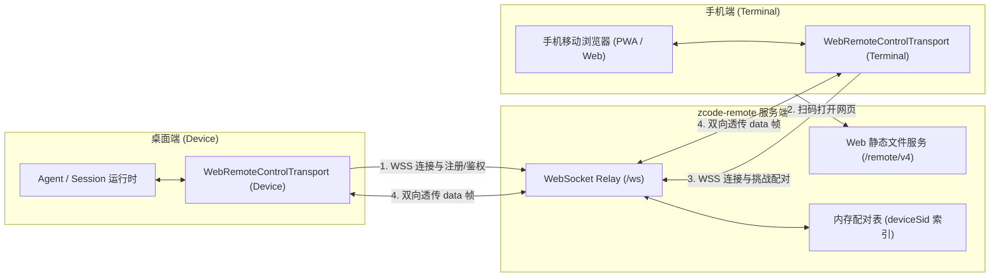
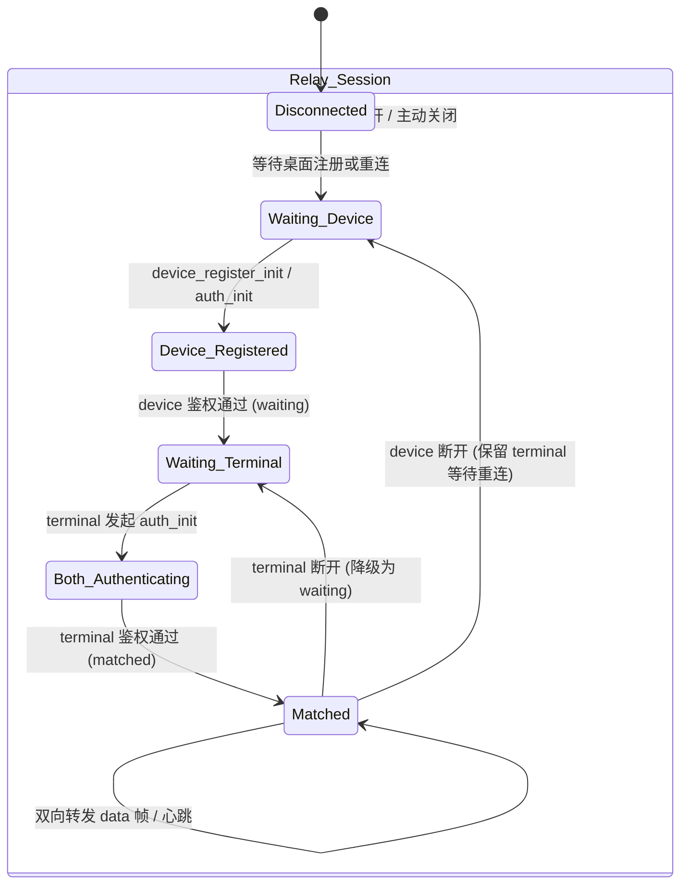

# ZCode Remote 架构设计规范

本文档定义 `zcode-remote`（ZCode 自建中继与远控网关）的整体架构、拓扑模型、状态机生命周期以及安全边界。

---

## 1. 架构目标与设计原则

1. **协议完全兼容**：对齐 ZCode 官方协议契约（`packages/shared/src/web-remote-control.ts`），保证未经任何魔改的 ZCode 桌面端及手机 Web 均可直接接入。
2. **零业务状态（Stateless Relay）**：Relay 仅负责连接调度、HMAC 挑战应答鉴权、配对状态维护和双向帧透传，不运行任何 Agent 任务，不持久化会话记录与快照。
3. **数据隐私红线（Zero Logging of Payloads）**：由于数据帧（`data`）在传输层 TLS 解密后为明文 RPC / JSON，Relay **严禁**记录任何 `payload` 内容或用户提示词。
4. **轻量与多宿主（Multi-Target Deployment）**：核心逻辑为纯 TypeScript，无 C++ 原生绑定依赖，可运行于轻量 Node.js、Docker 容器以及 Cloudflare Workers / Serverless 运行时。

---

## 2. 拓扑结构

---

## 3. 核心实体与概念

| 概念 | 角色/标识 | 说明 |
| :--- | :--- | :--- |
| **Device** | 桌面端客户端 (`role: "device"`) | 运行在用户 PC 上，拥有真正的文件系统和 Agent 执行能力。 |
| **Terminal** | 网页远控端 (`role: "terminal"`) | 运行在手机浏览器中，仅作为远程 UI 投影和输入控制器。 |
| **deviceSid** | 设备会话 ID（如 `d_Xx8a...`） | 唯一标识一次远控设备配对生命周期，由 Relay 分配或由 Desktop 持久化提供。 |
| **deviceMid** | 设备机器唯一标识 | 桌面客户端硬件/系统派生的唯一指纹，用于多实例分流。 |
| **passHash** | 配对密钥哈希 | `passHash = sha256(password).base64`，二维码中携带，用于双方 HMAC 证明。 |
| **nonce** | 随机挑战盐值 | Relay 发给客户端的一次性随机串，防止重放攻击。 |

---

## 4. 连接与配对状态机

### 4.1 核心阶段说明

1. **设备注册与初始连接 (Registration / Auth)**
   - 首次启动：Desktop 发送 `device_register_init`，Relay 生成新 `device_sid`，保存该 sid 的 `pass_hash`。
   - 二次启动/持久化：Desktop 直接发送 `auth_init`（携带本地已有的 `device_sid`）。
   - 挑战应答：Relay 生成随机 `nonce` 并返回 `auth_challenge`，Desktop 计算 HMAC 证明回传 `auth_response`。Relay 验证通过后进入 `waiting`（等待手机接入）。

2. **手机接入与配对 (Terminal Pairing)**
   - 手机扫码打开网页，从 URL 参数中解析出 `device_sid` 与 `pass_hash`。
   - 手机连入 Relay，发送 `auth_init (role: "terminal", device_sid)`。
   - Relay 同样下发 `auth_challenge (nonce)`，手机用本地 URL 中的 `pass_hash` 计算 Terminal 角色的 HMAC 证明并回传。
   - Relay 验证通过后，将配对状态标记为 `matched`，向双端发送 `pair_status_ack { pair_status: "matched" }`。

3. **双向透传 (Data Forwarding)**
   - 一旦状态为 `matched`，任一端发送 `{ type: "data", payload: ... }`，Relay 立即原样转发给对端。
   - 若对端离线，根据协议返回 `INTERNAL` 或 `DEVICE_OFFLINE`。

4. **单终端排他冲突处理 (Conflict & KICK)**
   - 同一个 `device_sid` 在同一时间**只允许连接一个手机 Terminal**。
   - 若已有活动 Terminal 时，新的 Terminal 尝试配对成功，旧 Terminal 将收到 `{ type: "error", code: "KICKED" }` 并被主动关闭。

---

## 5. 安全与隐私架构

1. **传输层加密**：公网环境下必须强制开启 TLS（`wss://` 和 `https://`）。
2. **零数据落盘（Zero Data At Rest）**：Relay 进程仅在内存中维护 `Map<deviceSid, RelaySession>`，进程重启即销毁。日志中只允许记录连接建立、心跳和错误码，**严禁将 `data` 帧写入持久化日志**。
3. **入口防护**：分两层，职责不同。

   **基础层 —— 端口只绑本机（必做）**：`ports: ["127.0.0.1:8765:8765"]` 让中继无法被公网直连，
   只接受同机反向代理转发。这是唯一两端零改动的防护方式，也是推荐做法。

   **可选层 —— 入口凭据**：中继自带 `RELAY_AUTH_TOKEN`，也可用 nginx `auth_basic`。
   两者都需要把凭据注入到连接地址里，而 ZCode 两端默认都不携带：

   | 端 | 注入点 |
   | :--- | :--- |
   | 桌面端 | `ZCODE_WEB_REMOTE_CONTROL_RELAY_WS_URL` 里带 `?token=` 或 `user:pass@` |
   | 手机端 | `ZCODE_WEB_REMOTE_CONTROL_URL` 里带 `?relay=` 或 `user:pass@`（会进入二维码） |

   > 设置面板的「自定义服务器地址」不是有效注入点：`resolveWebRemoteControlCustomEndpointUrls`
   > 会重建 `relayWsUrl`，输入的 query 与 userinfo 都会被丢掉。
   >
   > 注意凭据会明文出现在二维码、浏览器地址栏与桌面端启动配置里。只在你信任
   > 「能看到二维码的人」时才用。详见 [DEPLOYMENT.md](DEPLOYMENT.md) 的专节说明。

4. **辅助端点最小暴露**：`/health` 默认只返回存活信息（`status` / `sessions` / `uptime` / `time`）。
   设备明细（`device_mid`、机器名）需显式设置 `HEALTH_DETAILS=1` 才返回，避免该端点
   随反向代理暴露后泄露设备身份。
